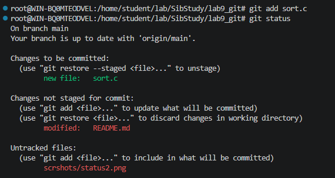
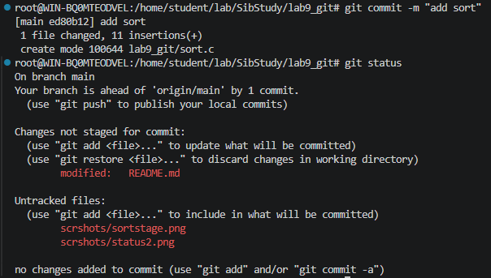
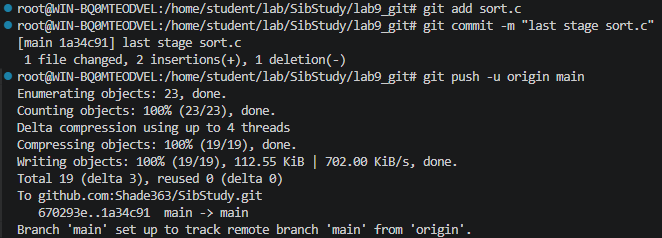
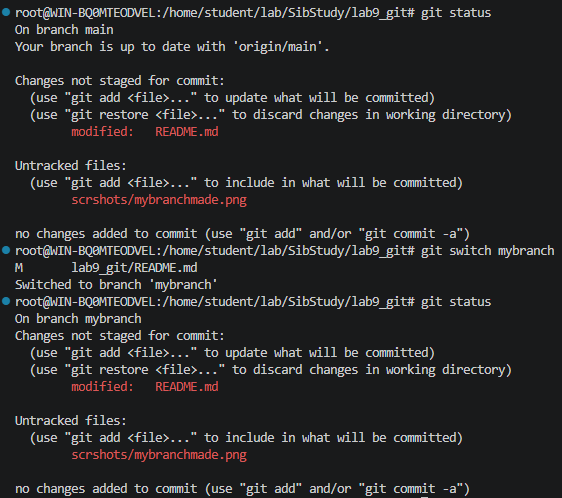
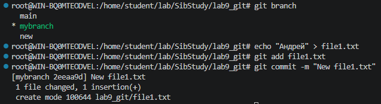
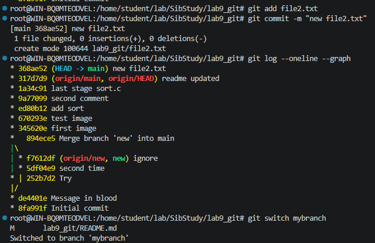

# Отчёт лабораторной работы №9

1) Использую git status для проверки текущей ветки и git log для просмотра действий:

2) Создам функцию сортировки и снова проверю git status:

 
3) Добавлю файл в stage и проверю git status:

4) Выполню commit и проверю git status:

5) Добавлю комментарий в sort.c и проверю git status:

6) Добавлю изменение файла и проверю git status:

7) Добавлю еще один комментарий в файл и выполню коммит:

8) Посмотрю как сейчас выглядит git status и log:

9) Добавлю в изменения второй комментарий и сделаю коммит, после чего запушу на гитхаб:

## ВЕТКИ

1) Создам новую ветку mybranch и посмотрю список всех веток:

2) Посмотрю, как изменяется git status при переключениями между ветками:

В строке вывода On branch main изменилось на On branch mybranch

3) Удостоверюсь, что нахожусь на ветке mybranch, после чего file1.txt со своим именем, затем добавлю файл в изменения и выполню коммит:

4) Использую git log --oneline --graph, чтобы увидеть, что наша ветка
указывает на новый коммит, после переключусь на ветку main и использую вышеупомянутю команду снова:

Заметим, что в графе ветки main отсутствует последний коммит с файлом file1.txt

5) Создам новый файл file2.txt и закоммитчу его, после использую команду git log --oneline --graph чтобы убедиться в последнем коммите. Далее, переключусь на ветку mybranch:

Заметим, что при переходе на другую ветку пропал файл file2.txt, но зато появился file1.txt

6) Наглядно сравню ветки используя git diff:

7) Добавлю текстовый документ со скриншотами в mybranch, сделаю коммит и пуш этой ветки:

8) Запушу изменения ветки main, после, удостоверюсь что на github.com лежат обе ветки:
