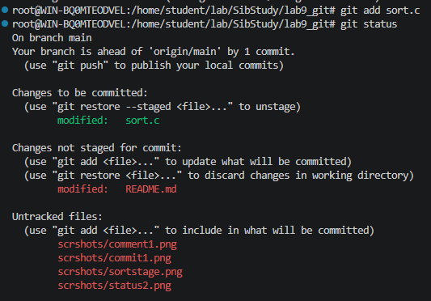
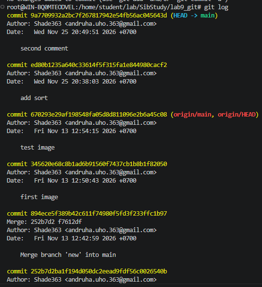

# Отчёт лабораторной работы №9

1) Использую git status для проверки текущей ветки и git log для просмотра действий:

2) Создам функцию сортировки и снова проверю git status:

 
3) Добавлю файл в stage и проверю git status:

4) Выполню commit и проверю git status:

5) Добавлю комментарий в sort.c и проверю git status:

6) Добавлю изменение файла и проверю git status:

7) Добавлю еще один комментарий в файл и выполню коммит:

8) Посмотрю как сейчас выглядит git status и log:

9) Добавлю в изменения второй комментарий и сделаю коммит, после чего запушу на гитхаб:

